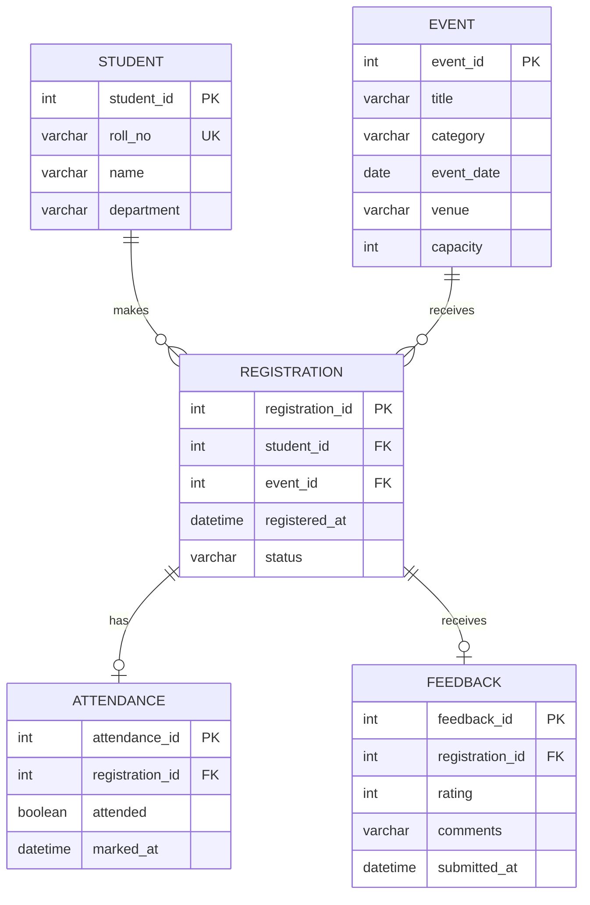

# ER Diagram

## Relational model
- STUDENT(**student_id**, roll_no, name, department)
- EVENT(**event_id**, title, category, event_date, venue, capacity)
- REGISTRATION(**registration_id**, student_id FK, event_id FK, registered_at, status), UNIQUE(student_id, event_id)
- ATTENDANCE(**attendance_id**, registration_id FK UNIQUE, attended, marked_at)
- FEEDBACK(**feedback_id**, registration_id FK UNIQUE, rating, comments, submitted_at)

## Normalization
- 1NF: every column contains atomic values; no repeating groups.
- 2NF: tables use single-column primary keys, so non-key attributes depend on the whole key. Registration's student/event pair is additionally unique.
- 3NF: student details are stored only in STUDENT, event details only in EVENT, and registration-specific facts only in REGISTRATION. Attendance and feedback are separate dependent records. This avoids transitive and repeated facts.
