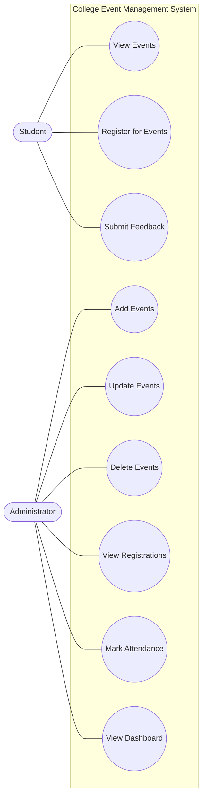

# USE CASE DIAGRAM
## College Event Management and Participation Analysis System

### Actors

1. Student
2. Administrator

### Student Use Cases

- View Events
- Register for Events
- Submit Feedback

### Administrator Use Cases

- Add Events
- Update Events
- Delete Events
- View Registrations
- Mark Attendance
- View Dashboard

### Use Case Diagram

